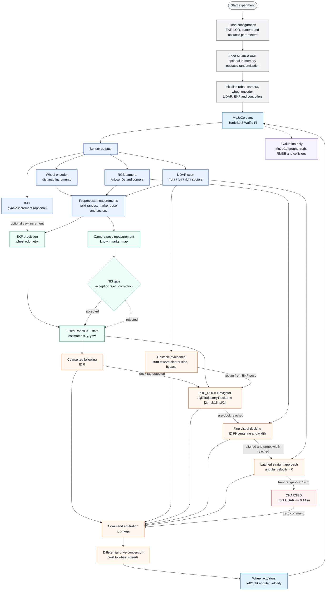

# Track A: TurtleBot3 EKF + LQR Navigation and ArUco Docking

**41014 Sensors and Control in Mechatronics Systems, Assessment 4: Integrated Project**

**Team:** Lachlan Cameron, Jonathan Wijaya, William Hsu

**Group:** 25

**Demo video (5 min): https://youtu.be/TScBIPqU-s8

**Platform:** Simulation (MuJoCo). Hardware: N/A

## 1. Overview

Autonomous Docking TurtleBot3 Project where demonstrated using MuJoCo simulation. The robot integrates wheel encoder odometry, camera-based ArUco marker detection, LiDAR obstacle detection, Extended Kalman Filter (EKF) state estimation, and Linear Quadratic Regulator (LQR) trajectory tracking.

The system initially detects ArUco marker ID 0 and uses marker ID 99 for fine docking alignment. The EKF estimates the robot's position and orientation, while LQR-based navigation controls its approach toward the pre-docking location.

## 2. Install and run

See [SETUP.md](SETUP.md) for the environment setup on Mac and Windows.

The primary integrated docking experiment is:

```bash
python3 tests/ekf_docking_test.py
```

Useful options include:

```bash
python3 tests/ekf_docking_test.py --random-scene --scene-seed 92 --obstacle-count 3
python3 tests/ekf_docking_test.py --docking-mode legacy-pixel
python3 tests/ekf_docking_test.py --no-ghost
```

Scene randomisation changes the compiled MuJoCo model in memory; it does not
modify or generate XML files. The ghost box shows the EKF pose estimate in the
passive MuJoCo viewer and can be disabled with `--no-ghost`.

## 3. System architecture

### Block diagram



Constraint: the controller uses the estimated state only. Simulator ground truth is used for evaluation only.

## 4. Modelling (Part A)

### 4.1 State, input and equations

State vector:

$$
\mathbf{x} = \begin{bmatrix} x \\ y \\ \theta \end{bmatrix}
$$

Control vector:

$$
\mathbf{u} = \begin{bmatrix} v \\ \omega \end{bmatrix}
$$

Where:

- $v$: Linear velocity (m/s).
- $\omega$: Angular velocity (rad/s).

Differential-drive kinematic equations:

$$
\dot{x} = v\cos\theta
$$

$$
\dot{y} = v\sin\theta
$$

$$
\dot{\theta} = \omega
$$

$$
v = \frac{r}{2}(\omega_R + \omega_L)
$$

$$
\omega = \frac{r}{L}(\omega_R - \omega_L)
$$

Where:

- $r$: Wheel radius (m).
- $L$: Distance between the left and right wheels (m).
- $\omega_R$: Right wheel angular velocity (rad/s).
- $\omega_L$: Left wheel angular velocity (rad/s).

## 5. Sensing and Calibration (Part B)

### 5.1 Sensor Configuration

Four sensor interfaces are implemented for navigation, localisation and
obstacle avoidance. IMU gyro fusion is optional and is enabled through the
EKF configuration.

| Sensor | Measurement | Purpose |
|---|---|---|
| Wheel Encoders | Left and right wheel displacement | Predict robot motion in the EKF |
| IMU | Angular velocity, using the Z-axis gyro | Optional yaw-increment fusion with wheel odometry |
| RGB Camera | ArUco marker ID, corners and relative pose | Detect navigation targets and correct the EKF estimate |
| LiDAR | Distance to nearby obstacles | Detect obstacles and support collision avoidance |

The production pipeline can fuse the IMU gyro-Z increment with wheel odometry
when `ekf.gyro_enabled` is enabled. The primary
[`ekf_docking_test.py`](tests/ekf_docking_test.py) experiment currently uses
wheel odometry plus camera pose corrections; the IMU path is available in the
configurable Track A pipeline.

### 5.2 Coordinate Frames

The system uses four coordinate frames:

- **World Frame:** Global reference for the robot's position and navigation targets.
- **Robot Base Frame:** Local coordinate system for TurtleBot3.
- **Camera Frame:** Coordinate system used for camera measurements and marker detection.
- **ArUco Marker Frame:** Local coordinate system attached to each marker.

The coordinate transformation from the camera to the robot and world frames is required to convert marker observations into global robot pose measurements.

The relationship between coordinate frames can be represented as:

$$
T_{WM} = T_{WB}\,T_{BC}\,T_{CM}
$$

Where:

- $T_{WM}$: Marker pose in the world frame.
- $T_{WB}$: Robot base pose in the world frame.
- $T_{BC}$: Camera pose relative to the robot base.
- $T_{CM}$: Marker pose relative to the camera.

Rearranging gives:

$$
T_{WB} = T_{WM}\,T_{CM}^{-1}\,T_{BC}^{-1}
$$

This allows the camera measurement to be transformed into the robot's global pose for EKF correction.

### 5.3 Camera Calibration and ArUco Detection

The RGB camera is used to detect ArUco markers and estimate the robot's pose relative to known landmarks.

The camera detection process consists of:

1. Detecting ArUco markers using OpenCV.
2. Extracting marker IDs and corner coordinates.
3. Estimating marker pose using camera calibration parameters and known marker dimensions.
4. Providing the resulting robot pose measurement to the EKF.

The system uses:

| Parameter | Value |
|---|---|
| ArUco dictionary | DICT_5X5_100 |
| Coarse navigation marker | ID 0 |
| Fine docking marker | ID 99 |
| Camera update interval | 1/30 s |
| Coarse marker size | 0.20 m |
| Fine marker size | 0.05 m |

Camera calibration requires the intrinsic matrix:

$$
K = \begin{bmatrix} f_x & 0 & c_x \\ 0 & f_y & c_y \\ 0 & 0 & 1 \end{bmatrix}
$$

Where:

- $f_x, f_y$: Camera focal lengths in pixels.
- $c_x, c_y$: Principal point coordinates.

The camera model may also include distortion coefficients to correct lens distortion.

Camera observations are first filtered by marker-pose validity and
reprojection error, then the resulting absolute pose is accepted by the EKF
only when it passes the innovation-gating test.

### 5.4 LiDAR Processing

LiDAR is implemented for obstacle detection and avoidance across the robot's forward-facing region, from -90° to +90° at 15° intervals.

The measurements are then grouped into three sectors:

| Sector | Angular Range | Purpose |
|---|---|---|
| Front | -30° to +30° | Detect obstacles directly ahead |
| Left | +45° to +90° | Evaluate clearance on the left |
| Right | -90° to -45° | Evaluate clearance on the right |

The minimum valid distance in each sector is used for obstacle detection.

The main obstacle avoidance parameters are:

| Parameter | Value |
|---|---|
| Stop distance | 0.20 m |
| Clearance distance | 0.40 m |
| Avoidance distance | 0.50 m |
| Avoidance turn angle | 35° |
| Avoidance angular velocity | 0.45 rad/s |

When an obstacle is detected, the robot can stop, turn toward the clearer direction and move forward to bypass it.

During pre-docking, LiDAR measurements are passed to the `Navigator`, which
uses an `LQRTrajectoryTracker` and can interrupt tracking for the
obstacle-avoidance state machine. After avoidance, navigation continues from
the updated EKF pose.

### 5.5 Sensor Noise Characterisation

Sensor measurements contain uncertainty caused by simulation noise, numerical errors and limitations of the sensing models.

The EKF represents uncertainty using process noise covariance $Q$ and measurement noise covariance $R$.

For camera pose measurements, the integrated script uses:

$$
R_{\text{camera}} = \begin{bmatrix} 0.08^2 & 0 & 0 \\ 0 & 0.08^2 & 0 \\ 0 & 0 & (5\pi/180)^2 \end{bmatrix}
$$

This corresponds to assumed standard deviations of:

- X-position: 0.08 m.
- Y-position: 0.08 m.
- Heading: 5°.

The camera correction uses a chi-square innovation gate with a threshold of 11.345, corresponding to a 99% confidence threshold for three measurement dimensions.

## 6. Estimation (Part C)

### 6.1 EKF Design and Parameters

The production EKF state is:

$$
\mathbf{x} = [x,\ y,\ \theta]^T
$$

where $(x,y)$ is the robot pose in the world frame and $\theta$ is yaw. The
primary docking experiment uses wheel encoder distances for prediction and
calibrated ArUco observations for absolute-pose correction.

- **Prediction:** `WheelEncoder` converts wheel-joint motion into left and
  right wheel distances. `RobotEKF.predict()` applies the differential-drive
  motion model and propagates the covariance using distance-dependent wheel
  noise.
- **Correction:** A known marker map and the camera pose estimate are used to
  construct an absolute $[x,y,\theta]$ robot-pose measurement. The EKF applies
  an identity-measurement update when the innovation passes the NIS gate.
- **Angle handling:** Yaw innovations and the stored yaw state are wrapped to
  $[-\pi,\pi)$.
- **Numerical stability:** The covariance is symmetrised after prediction and
  the correction uses the Joseph covariance form.

EKF parameter table:

| Parameter | Value | Justification |
|---|---|---|
| State | $[x,y,\theta]$ | Planar world-frame pose |
| Wheel noise coefficient | $1.0\times10^{-4}$ | Distance-dependent variance contribution |
| Wheel noise floor | $(1.0\times10^{-5}\,\mathrm{m})^2$ | Prevents zero process variance |
| Camera covariance $R$ | $\mathrm{diag}(0.08^2,0.08^2,5^\circ{}^2)$ | Assumed absolute-pose measurement uncertainty |
| Initial covariance $P_0$ | $\mathrm{diag}(0.15^2,0.15^2,15^\circ{}^2)$ | Initial pose uncertainty in `ekf_docking_test.py` |
| Innovation gate | 11.345 | 99% chi-square gate for 3 pose dimensions |

### 6.2 Tuning, Consistency Checks and Performance

For each camera correction, the innovation is:

$$
\boldsymbol{\nu} = \mathbf{z} - \hat{\mathbf{x}}
$$

with yaw wrapped before calculating the normalized innovation squared (NIS).
Measurements with $\mathrm{NIS} > 11.345$ are rejected; accepted measurements
reduce the pose uncertainty. Rejected measurements do not overwrite the EKF
state.

Performance can be evaluated by comparing the EKF-estimated trajectory against MuJoCo ground truth using position and heading RMSE.

When no usable marker is visible, the EKF continues predicting from wheel
encoders and its covariance can increase. In the primary
`ekf_docking_test.py` run, IMU fusion is disabled and accelerometer data is not
used. The configurable Track A pipeline can optionally fuse gyro-Z increments
with wheel odometry when `ekf.gyro_enabled` is enabled; this is an optional
extension rather than part of the primary docking result.

## 7. Control (Part D)

### 7.1 Controller Architecture

The project uses a hybrid control system consisting of ArUco marker following, LQR-based navigation and visual docking.

| Control Stage | Controller | Function |
|---|---|---|
| Initial navigation | TagFollower | Track coarse ArUco marker ID 0 |
| Obstacle avoidance | LiDAR-based navigation | Avoid obstacles during movement |
| Pre-docking | Navigator + LQRTrajectoryTracker | Navigate to the pre-docking pose |
| Fine docking | `VisualDockingController` | Filter and align with ArUco marker ID 99 |
| Docking completion | LiDAR stop and confirmation | Stop at a front-LiDAR range of 0.14 m and enter simulated `CHARGED` |

During the PRE_DOCK stage, `Navigator` supplies the reference and safety logic
while `LQRTrajectoryTracker` uses the EKF-estimated pose as feedback.

### 7.2 LQR Controller Design

The Linear Quadratic Regulator (LQR) minimises tracking error while penalising excessive control corrections.

The LQR objective function is:

$$
J = \sum_{k=0}^{\infty}\left(\mathbf{e}_k^T Q\,\mathbf{e}_k + \Delta\mathbf{u}_k^T R\,\Delta\mathbf{u}_k\right)
$$

Where:

- $\mathbf{e}$: Robot tracking error.
- $Q$: State tracking-error weighting matrix.
- $R$: Control-effort weighting matrix.
- $\Delta\mathbf{u}$: Control correction.

The optimal feedback gain is obtained by solving the discrete algebraic Riccati equation.

The controller applies a state-feedback correction using the estimated pose and reference trajectory.

The generated linear and angular velocities are converted into left and right wheel angular velocities.

### 7.3 LQR Parameters and Weight Selection

| Weight | Function |
|---|---|
| $Q_{11}$ | Penalises longitudinal tracking error |
| $Q_{22}$ | Penalises lateral tracking error |
| $Q_{33}$ | Penalises heading error |
| $R_{11}$ | Penalises linear velocity correction |
| $R_{22}$ | Penalises angular velocity correction |

Increasing a state-error weight generally encourages stronger correction of that error, while increasing a control-effort weight discourages aggressive control corrections.

The pre-docking controller limits the commanded velocities to:

| Parameter | Maximum |
|---|---|
| Linear velocity | 0.10 m/s |
| Angular velocity | 0.45 rad/s |

These limits help prevent excessively aggressive movements during docking.

### 7.4 LQR Tuning Method

The controller exposes $Q$ and $R$ so that different configurations can be
compared under identical initial conditions. The repository currently
documents the configured values but does not contain a recorded comparative
Q/R sweep.

The main performance metrics are:

- Position tracking RMSE.
- Heading tracking error.
- Settling time.
- Control effort.
- Pre-docking success rate.

Control effort can be evaluated using:

$$
J_u = \sum_{k=1}^{N}\left(v_k^2 + \omega_k^2\right)\Delta t
$$

For a dimensionally consistent comparison, the linear and angular terms should be normalised or weighted before being combined.

The selected Q and R values should provide an appropriate balance between tracking accuracy, settling time and control activity.

### 7.5 LQR Tracking Results

| Configuration | Q Diagonal | R Diagonal | Position RMSE (m) | Settling Time (s) |
|---|---|---|---|---|
| Configured controller | (1.0, 1.0, 0.5) | (0.1, 0.1) | Not recorded | Not recorded |

No comparative Q/R sweep results are recorded in this repository; the table
documents the configured values rather than claiming measured performance.

### 7.6 Final Visual Docking

After the robot reaches the pre-docking pose, control switches from LQR to visual docking.

The pre-docking target is:

$$
\mathbf{x}_{\text{dock}} = \begin{bmatrix} 2.4 \\ 2.15 \\ \pi/2 \end{bmatrix}
$$

The transition conditions are:

- Position error no greater than 0.10 m.
- Heading error no greater than 8°.

During visual docking, the robot follows ArUco marker ID 99 and estimates proximity using the detected marker width.

The visual controller adjusts linear and angular velocities to align the robot with the charging station.

When the front LiDAR reaches 0.14 m during the latched straight approach,
the robot stops and enters the simulated `CHARGED` state. Legacy pixel mode
also requires its configured multi-frame docking confirmation.

In the final docking stage, LQR is not used; the robot uses visual feedback with LiDAR logic instead.

## 8. Integration and Robustness (Part E)

### 8.1 Obstacle Avoidance

The LiDAR is configured between -90° and 90° with 15° spacing.

Obstacle avoidance parameters:

| Parameter | Value |
|---|---|
| Stop distance | 0.20 m |
| Clearance threshold | 0.40 m |
| Avoidance distance | 0.50 m |
| Avoidance turn angle | 35° |
| Avoidance forward velocity | 0.15 m/s |
| Avoidance angular velocity | 0.45 rad/s |

Avoidance sequence:

1. **Obstacle Detection:** When an obstacle is detected within the clearance threshold during forward movement, the robot enters AVOID_TURN.
2. **Direction Selection:** The robot compares left and right LiDAR clearance and selects the direction with greater available space.
3. **Turning:** The robot rotates approximately 35° to avoid the obstacle.
4. **Forward Movement:** After turning, the robot enters AVOID_FORWARD and travels approximately 0.50 m.
5. **Obstacle Rechecking:** If another obstacle is detected within the stop distance, the robot returns to AVOID_TURN.
6. **Navigation Resumption:** Once the avoidance movement is completed, the robot returns to normal navigation.

During the PRE_DOCK stage, LiDAR readings are supplied to the `Navigator`,
which selects the clearer side for the avoidance turn while the
`LQRTrajectoryTracker` follows the pre-dock reference. After the avoidance
segment, navigation continues from the EKF estimate.

### 8.2 Integration Testing

Integration testing evaluates whether the sensing, estimation, navigation, and docking subsystems operate together correctly.

| Test | Objective | Expected Behaviour |
|---|---|---|
| Sensor integration | Verify encoder, camera and LiDAR measurements | Sensors provide valid data |
| EKF integration | Verify odometry prediction and camera correction | Robot pose estimate updates correctly |
| LQR integration | Verify EKF-based pre-docking navigation | Robot approaches the reference pose |
| Obstacle avoidance | Place obstacles along the navigation path | Robot detects and avoids obstacles |
| Marker switching | Test transitions from ID 0 to ID 99 | Robot enters the appropriate docking stage |
| Docking completion | Approach the charging station | Robot stops when docking conditions are satisfied |

These tests assess the interaction between subsystems rather than evaluating each component independently.

### 8.3 Robustness Testing Under Varied Conditions

The simulation supports testing different environment conditions by changing
obstacle positions at runtime:

```bash
python3 tests/ekf_docking_test.py --random-scene --scene-seed 92 --obstacle-count 3
```

Different scene seeds and obstacle counts can be used to evaluate the system under varied conditions.

| Experiment | Test Condition | Evaluation Metric |
|---|---|---|
| Baseline | Fixed starting pose and obstacle layout | Docking success and completion time |
| Random obstacles | Different obstacle positions | Success rate and collision count |
| Initial pose variation | Different robot starting positions | Navigation success and tracking error |
| Sensor noise | Increased encoder or camera noise | EKF estimation accuracy |
| LQR tuning | Different Q and R values | Tracking error and settling time |

Repeated trials can be used to evaluate repeatability, but recorded
multi-trial results are not included in this repository.

## 9. Contribution Statement

| Member | Contribution |
|---|---|
| Lachlan | Developed the LQR controller, pre-docking navigation, camera sensing and ArUco detection, differential-drive modelling, and randomised obstacle generation. |
| Jonathan | Set up the initial MuJoCo simulation environment, developed the initial obstacle avoidance and docking logic, implemented LiDAR processing for obstacle detection. |
| William | Developed the Extended Kalman Filter (EKF), implemented wheel encoder odometry, integrated camera measurements and scene randomisation, and contributed to robot localisation and state estimation. |
| All Members | Integration of multiple state machines; collaboratively tested, debugged, and evaluated the integrated system, including EKF and LQR performance, navigation accuracy, and docking reliability. |

## 10. Generative AI Declaration

Integrating multiple state logic machine into a single running code, where combine navigation, obstacle avoidance, EKF, and LQR seamlessly.
